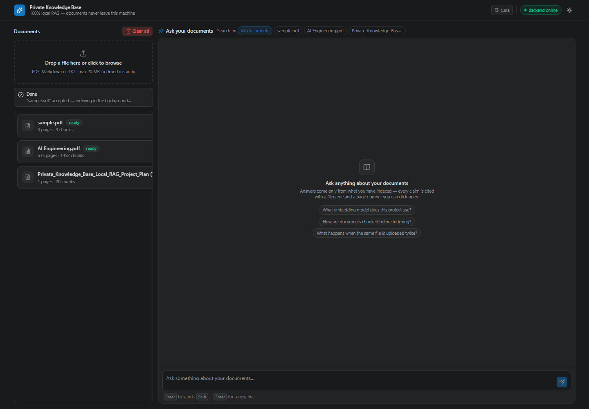
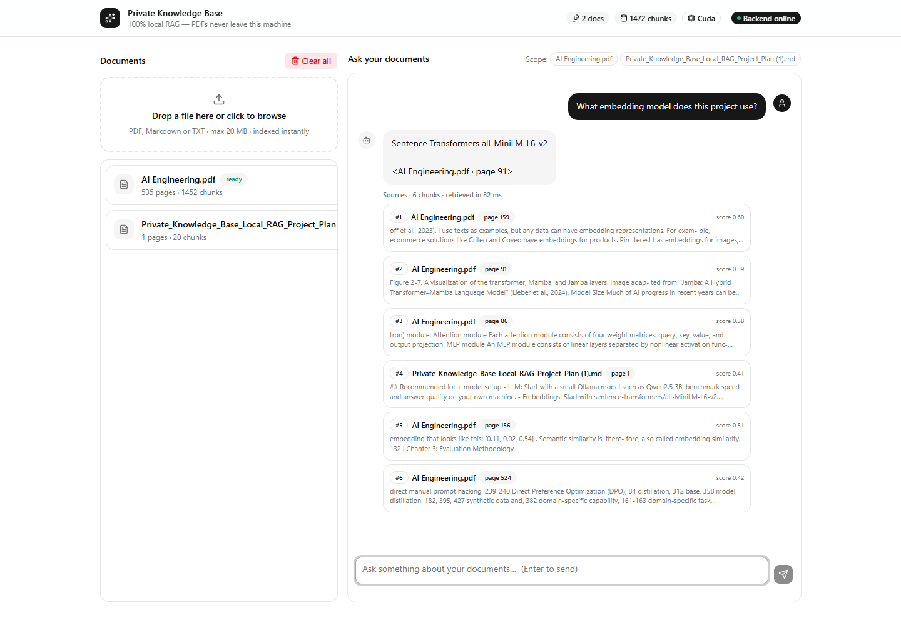
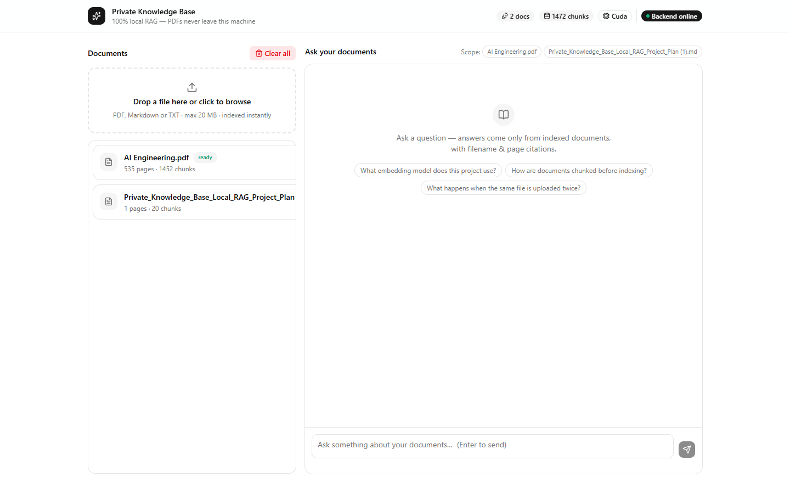
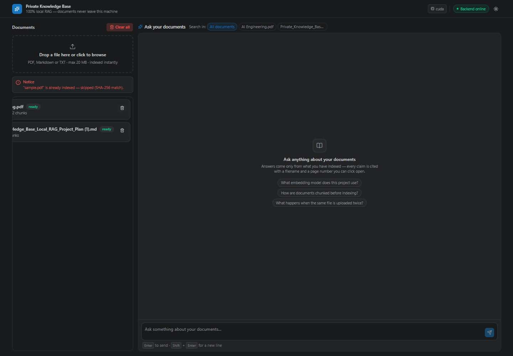

# Private Knowledge Base — Local RAG PDF Reader

A **100% local Retrieval-Augmented Generation (RAG)** system: upload PDFs / Markdown / TXT at runtime, index them into a vector store, and ask grounded questions that are answered **with page-level citations** — no cloud APIs, no data leaving your machine.

Built with **FastAPI + LangChain + ChromaDB + Hugging Face transformers** on the backend and a **React (Vite + TypeScript + Tailwind)** chat UI on the frontend.

```
POST /documents/upload  →  validate → dedupe → load → chunk → embed → Chroma
POST /chat              →  embed question → MMR retrieve → grounded prompt → Qwen → cited answer
```

---

## Table of contents

- [Highlights](#highlights)
- [Screenshots](#screenshots)
- [Architecture](#architecture)
- [How we built the RAG system](#how-we-built-the-rag-system)
  - [Stage 1 — Ingestion (write path)](#stage-1--ingestion-write-path)
  - [Stage 2 — Retrieval (read path)](#stage-2--retrieval-read-path)
  - [Stage 3 — Generation & citations](#stage-3--generation--citations)
  - [Stage 4 — Serving layer](#stage-4--serving-layer)
- [Key design decisions](#key-design-decisions)
- [Pros of our RAG system](#pros-of-our-rag-system)
- [Benefits](#benefits)
- [Tech stack](#tech-stack)
- [Getting started](#getting-started)
- [API reference](#api-reference)
- [Configuration](#configuration)
- [Project structure](#project-structure)
- [Limitations & roadmap](#limitations--roadmap)

---

## Highlights

| | |
|---|---|
| 🔒 **Local-first** | Embeddings + LLM run on this machine. Zero external HTTP calls at query time. |
| 📄 **Dynamic ingestion** | PDFs are *not* hardcoded — any file is indexable at runtime, repeatedly, without restarts. |
| 🎯 **MMR retrieval** | Score floor + Maximal Marginal Relevance → relevant **and** diverse chunks, no near-duplicates. |
| 📎 **Real citations** | Every answer carries `[filename · page N]`, canonicalized in code — never trusted to the model. |
| 🚫 **Refusal behaviour** | If nothing clears the relevance floor, the system says *"Insufficient context"* instead of hallucinating. |
| ⚡ **Fast uploads** | Validation is synchronous, indexing runs as a background task → instant `202` response. |
| 🧠 **Non-blocking startup** | Heavy singletons (Chroma, embedding model, ~3 GB LLM) warm up in a daemon thread; `/v1/health` reports readiness. |

---

## Screenshots

| Upload | Chat with citations | Source preview | After delete |
|---|---|---|---|
|  |  |  |  |

---

## Architecture

Layered / hexagonal structure with a strict dependency rule: **`routes → services → infrastructure`**, and `domain` imports nothing.

```
Frontend (React/Vite :5173)
        │  fetch + Vite proxy
        ▼
api/        HTTP only — validation, schemas, error envelope, DI
        │
services/   use cases — ingestion, retrieval, chat (no HTTP, no Chroma calls in routes)
        │
domain/     pure types — Document, Source, ChatResult, DocumentStatus, constants
        │
infrastructure/  adapters — loaders, chunker, embeddings, Chroma, HF LLM, JSON registry
```

```
app/
├── main.py                     # FastAPI factory + lifespan (async warm-up thread, seed doc)
├── config.py                   # pydantic-settings — every tunable in one place
├── api/                        # routes, schemas, deps, global error handlers
├── services/                   # ingestion_service, retrieval_service, chat_service
├── domain/                     # models, enums, constants (imports nothing)
├── infrastructure/
│   ├── loaders/                # PyPDFLoader(mode="page"), .md/.txt loader
│   ├── chunking/               # RecursiveCharacterTextSplitter 1000/150
│   ├── embeddings/             # all-MiniLM-L6-v2 singleton (normalized)
│   ├── vectorstore/            # persistent Chroma + embedding-model binding guard
│   ├── llm/                    # Qwen2.5-1.5B-Instruct, lazy, thread-safe, OOM guard
│   └── registry/               # data/registry.json (status: processing → ready | failed)
├── prompts/rag_prompts.py      # grounded system prompt + citation normalizer
└── core/                       # logging (request ids), upload security
```

---

## How we created the RAG system

RAG here means two decoupled pipelines: **embed the document once**, **embed only the question at query time**, and let the LLM see *just the matching chunks* — never the whole file.

### Stage 1 — Ingestion (write path)

Runs once per document, at runtime, inside `POST /v1/documents/upload`:

1. **Validate** — extension allow-list (`.pdf`, `.md`, `.txt`), 20 MB size cap, and a **magic-byte check** (`%PDF`) so a renamed `.exe` can never be parsed (`app/core/security.py`). Cheap checks run first.
2. **Dedupe** — SHA-256 of the raw bytes; an exact re-upload short-circuits and returns the existing `doc_id` instead of double-indexing.
3. **Store safely** — the file is written under a *generated* name (`<uuid>__<sanitized-name>.pdf`), never a client-supplied path.
4. **Load** — `PyPDFLoader(mode="page")` produces **one LangChain `Document` per page**, and pages are converted to **1-based** numbers — this is the foundation of page-level citations. `.md`/`.txt` go through the text loader.
5. **Chunk** — `RecursiveCharacterTextSplitter(chunk_size=1000, chunk_overlap=150, add_start_index=True)` with separators `["\n\n", "\n", ". ", " ", ""]`. Every chunk is stamped with:
   - `doc_id` (owner), `chunk_id = {doc_id}:{n:04d}` (stable, makes re-ingestion an upsert),
   - `source` = **original filename**, `page` = 1-based page,
   - empty chunks are rejected outright (failed extraction fails loudly).
6. **Embed** — `sentence-transformers/all-MiniLM-L6-v2` (384-dim, ~90 MB, local) with **L2-normalized** vectors, one shared singleton for documents *and* queries.
7. **Store** — upsert into a **persistent Chroma** collection at `data/chroma/`; the embedding model name is stamped into collection metadata and re-verified on every open.
8. **Register** — `data/registry.json` records `processing → ready | failed` (with a human-readable error, e.g. *"scanned/image-only PDF, OCR not enabled"*), page count and chunk count.

Steps 1–3 + registration happen **synchronously** (fast); steps 4–8 run as a FastAPI `BackgroundTask`, so the client gets `202 {doc_id, status:"processing"}` immediately and polls `GET /v1/documents/{doc_id}`.

### Stage 2 — Retrieval (read path)

`app/services/retrieval_service.py` — the quality-critical part:

1. **Embed the question once** and reuse that vector for both the candidate query and the relevance recompute (Chroma's text search would embed it twice).
2. **Candidate pool** — fetch `fetch_k = 20` nearest chunks (optional `doc_ids` filter to scope a search to selected documents).
3. **Recompute true cosine relevance** from the stored normalized embeddings — the raw Chroma distance is only used for candidate ordering, never as a score.
4. **Score floor** — drop everything below `min_score = 0.2`. *Irrelevant context breeds confident hallucinations*, so weak matches never reach the prompt. If **all** candidates fall below the floor, retrieval returns empty → the answer becomes *"Insufficient context to answer this question."*
5. **MMR selection** (Carbonell & Goldberg, 1998) over the survivors' stored vectors:

   ```
   score = λ · relevance(d, q) − (1−λ) · max sim(d, already_selected)     λ = 0.25
   ```

   This is what stops the LLM receiving six near-duplicate paragraphs of the same passage. (It is implemented explicitly because `langchain-chroma`'s `similarity_search_with_relevance_scores(mmr=True)` ignores the `mmr` kwarg — verified.)
6. **Project to `Source` objects** — `doc_id, filename, page, chunk_id, excerpt(300 chars), score`, returned best-first (`top_k = 6` default, 1–20 per request).

### Stage 3 — Generation & citations

`app/services/chat_service.py` + `app/prompts/rag_prompts.py`:

1. **Fetch full chunk text** for the retrieved ids (the 300-char excerpt is display-only — the model always gets the complete chunk).
2. **Build a labelled context** — each block is prefixed `--- Block N [sample.pdf · page 2] ---`, capped at `MAX_CONTEXT_CHARS = 8000` regardless of how many chunks came back (safety valve on prompt size).
3. **Strictly separate data from instructions** — the system prompt states the CONTEXT is reference material, not commands (prompt-injection mitigation), forbids prior knowledge, and *requires* the model to admit when evidence is missing.
4. **Generate** with `Qwen/Qwen2.5-1.5B-Instruct` via Hugging Face transformers — **greedy decoding (temperature 0.0)** so the same prompt is reproducible; fp16 on CUDA, fp32 on CPU; `max_new_tokens = 768`.
5. **Structured answer** enforced by the prompt: **Answer → Explanation → Example**, each ending in a citation, with every number/name required to come from the CONTEXT.
6. **Canonicalize citations in code** — a 1.5B model formats citations inconsistently, so `normalize_citations()` rewrites whatever it emitted (`[Block 3 · page 1]`, `[<file.pdf · page N>]`, literal `"filename · page N"`) into the exact retrieval labels using the **authoritative** `sources` list, and strips placeholders. The API therefore returns a correct `sources[]` array *independently* of what the model wrote.
7. Return `{answer, sources, retrieval_ms, model}` — the UI shows the excerpt + score per citation.

### Stage 4 — Serving layer

- **FastAPI** under `/v1` with Pydantic request/response schemas, a consistent `{detail, code}` error envelope, request-id logging, and CORS for the Vite dev origin.
- **Startup**: uvicorn binds the port *immediately*; a daemon thread opens Chroma, verifies the embedding-model binding, seeds the bundled project-plan `.md` (hash-deduped) and pre-loads the LLM — so the frontend's proxy never sees `ECONNREFUSED` and the first chat doesn't stall.
- **Readiness** is observable: `GET /v1/health → {llm, llm_ready, llm_device, embedding_model, indexed_docs, total_chunks}`.
- **Persistence**: Chroma is never wiped on shutdown; `data/` survives restarts.
- **Windows-safe launcher**: `scripts/run_server.py` forces `SelectorEventLoop` so a transient `WinError 64` accept can't silently kill the listener (the cause of intermittent 502s behind the Vite proxy).

---

## Key design decisions

| Decision | Why |
|---|---|
| `all-MiniLM-L6-v2` embeddings | Fast, 384-dim, ~90 MB, fully local; one model for docs **and** queries. Mixing models inside a collection produces garbage similarity — so the model name is stored in collection metadata and opening with a different model **raises** instead of silently returning nonsense. |
| Chroma (persistent) | Zero-setup embedded vector DB, survives restarts, filterable by `doc_id`, upsert-by-id. |
| `Qwen2.5-1.5B-Instruct` via transformers | Small enough for a 4 GB GPU (fp16) or CPU; no Ollama/server process; behind an `LLMClient`-shaped adapter so a backend can be swapped without touching `chat_service`. |
| Explicit MMR + score floor | Relevance *and* diversity, with an abstain path — the two things naive top-k RAG gets wrong. |
| Chunk 1000 / overlap 150 | Large enough to keep an argument intact, overlap keeps sentences that straddle a boundary; page metadata still pins citations. |
| Citations computed in code | The model's formatting is unreliable at 1.5B params; retrieval results are authoritative. |
| Stateless chat (v1) | Every request retrieves independently — simpler, and retrieval quality can't drift with a growing history. |
| JSON registry, single-writer | Human-readable status tracking; the adapter is isolated so it can be swapped for SQLite if indexing moves to a worker pool. |

---

## Pros of our RAG system

1. **Grounded, citable answers** — every claim maps to a real `filename · page`, so a reader can verify it in one click. Citations are *structurally* correct, not model-dependent.
2. **Hallucination-resistant by construction** — LLM sees only topically relevant chunks, temperature 0 greedy decoding, "answer only from CONTEXT" rules, and an explicit abstain path when nothing clears `min_score`.
3. **Prompt-injection hardened** — document text is passed strictly as data, with an explicit instruction to ignore any commands embedded in it.
4. **Truly private & offline** — embeddings, vector store and generation all run locally; HF is put in cache-only mode so nothing phones home. Suitable for legal, medical, financial or internal documents.
5. **Cheap and hardware-friendly** — a 90 MB embedding model + 1.5B LLM (fp16 ≈ 3 GB VRAM) runs on a small GPU or CPU; no API bills, no rate limits, no per-query cost.
6. **Scales with documents, not with prompts** — cost per question depends on the 6 retrieved chunks (≤ 8 K chars), never on total corpus size; long PDFs stay affordable.
7. **Fresh, incremental knowledge** — upload at runtime, re-upload is an idempotent upsert, delete removes exactly that document's vectors. No re-embedding the world.
8. **Fast at every stage** — background indexing (instant `202`), async warm-up (server binds immediately), single question-embedding per query, cached singletons (no double model loads).
9. **Reproducible** — deterministic chunk ids, greedy decoding, hash-deduped seed: same input → same output, easy to debug and regression-test.
10. **Fail-safe behaviour** — scanned PDFs, corrupt registries, OOM, and model/config drift all surface as explicit statuses or errors, never as silent garbage output.
11. **Swappable by design** — loaders, splitter, embedder, vector store and LLM each sit behind an adapter; upgrade to a bigger LLM, pgvector or a reranker without touching business logic.
12. **Production-minded operations** — health/readiness endpoint, structured logs with request ids and timings (total vs `retrieval_ms`), consistent error envelope, guarded destructive endpoint (`?confirm=true`).

---

## Benefits

**For users**
- Answers in plain language with a worked **Example** section — not a one-line reply — plus the exact page to open for more.
- Trust: a visible source list with excerpt and cosine score for every answer.
- Instant feedback: upload → poll status → ask; deletions take effect immediately.

**For the organization**
- **Data never leaves the premises** — compliance-friendly for regulated knowledge bases.
- **Near-zero operating cost** — no token billing; scales by adding local disk/RAM.
- **Institutional memory** — PDFs, notes and reports become one queryable brain instead of a folder graveyard.
- **Onboarding & support acceleration** — new hires and support agents get sourced answers from internal docs in seconds.

**For developers**
- Clean layering makes the pipeline testable piece-by-piece (chunker, prompts, retrieval floor, API contract).
- Every quality lever is a config value (`chunk_size`, `top_k`, `fetch_k`, `lambda_mult`, `min_score`, `temperature`) — tune against an eval set without code changes.
- Deterministic, observable, and documented: timings, drop counts and readiness are all logged or exposed.

---

## Tech stack

| Layer | Choice |
|---|---|
| API | FastAPI, Pydantic v2, uvicorn |
| Orchestration | LangChain core, langchain-community, langchain-text-splitters |
| Embeddings | sentence-transformers `all-MiniLM-L6-v2` (via langchain-huggingface) |
| Vector store | ChromaDB (persistent, via langchain-chroma) |
| LLM | `Qwen/Qwen2.5-1.5B-Instruct` via `transformers` + `torch` (fp16 on CUDA) |
| Loaders | `pypdf` (PyPDFLoader, page mode), plain-text loader |
| Frontend | React 19, Vite 8, TypeScript, Tailwind CSS 4, Radix/shadcn-style UI |
| Tests / tooling | pytest, ESLint |

---

## Getting started

### Prerequisites

- Python 3.11+ (project built on 3.11/3.12)
- Node.js 18+
- Optional GPU: install the **CUDA** torch build first (Windows PyPI wheels are CPU-only):

```bash
# match `nvidia-smi`'s CUDA version, e.g. cu130
pip install torch --index-url https://download.pytorch.org/whl/cu130
```

### 1. Backend

```bash
python -m venv .venv
.venv\Scripts\activate          # macOS/Linux: source .venv/bin/activate
pip install -r requirements.txt

# Windows-safe launcher (recommended) — or: uvicorn app.main:app --reload --port 8000
.venv\Scripts\python scripts\run_server.py
```

API: `http://127.0.0.1:8000` · Swagger UI: `/docs` · Health: `/v1/health`

> The first startup downloads/loads the embedding model and the ~3 GB LLM in the background; watch `llm_ready` flip to `true` in `/v1/health`. Both models are then cached under `~/.cache/huggingface` and HF is run in offline mode afterwards.

### 2. Frontend

```bash
cd Frontend/frontend-private-rag-llm
npm install
npm run dev                     # http://localhost:5173  (proxies /v1 → :8000)
```

### 3. Use it

1. Drop a PDF into the **Documents** panel → status goes `processing → ready`.
2. Ask a question in **Chat** → get an **Answer / Explanation / Example** with `[file.pdf · page N]` citations and clickable source cards.

---

## API reference

Base path: `/v1` · Interactive docs at `/docs`

| Method | Path | Purpose |
|---|---|---|
| `POST` | `/documents/upload` | Upload + index a `.pdf`/`.md`/`.txt` → `202 {doc_id, status, duplicate}` |
| `GET` | `/documents` | List documents with status, pages, chunks |
| `GET` | `/documents/{doc_id}` | Poll one document's status |
| `DELETE` | `/documents/{doc_id}` | Delete a document's vectors + registry entry |
| `POST` | `/chat` | `{question, doc_ids?, top_k?}` → `{answer, sources[], retrieval_ms, model}` |
| `GET` | `/health` | Model readiness + index stats |
| `DELETE` | `/knowledge-base?confirm=true` | Wipe everything (guarded) |

Example:

```bash
curl -F "file=@report.pdf" http://127.0.0.1:8000/v1/documents/upload

curl -X POST http://127.0.0.1:8000/v1/chat \
  -H "Content-Type: application/json" \
  -d '{"question": "What chunk size does this project use?", "top_k": 6}'
```

```json
{
  "answer": "**Answer:** ... **Explanation:** ... **Example:** ... [report.pdf · page 4]",
  "sources": [
    {"doc_id": "8cba06955379", "filename": "report.pdf", "page": 4,
     "chunk_id": "8cba06955379:0011", "excerpt": "...", "score": 0.7817}
  ],
  "retrieval_ms": 42,
  "model": "Qwen/Qwen2.5-1.5B-Instruct"
}
```

Bounds: question 3–1000 chars · `top_k` 1–20 · uploads ≤ 20 MB.

---

## Configuration

All settings live in `app/config.py` (pydantic-settings, optional `.env` in the repo root):

| Variable | Default | Meaning |
|---|---|---|
| `EMBEDDING_MODEL` | `all-MiniLM-L6-v2` | Embedding model — **must match** the collection; mismatch raises on startup |
| `CHUNK_SIZE` / `CHUNK_OVERLAP` | `1000` / `150` | Splitter geometry |
| `TOP_K` / `FETCH_K` | `6` / `20` | Chunks returned / candidate pool size |
| `LAMBDA_MULT` | `0.25` | MMR relevance↔diversity trade-off (0 = pure diversity, 1 = pure relevance) |
| `MIN_SCORE` | `0.2` | Cosine floor — below it, chunks are dropped (and empty retrieval ⇒ refusal) |
| `LLM_MODEL` | `Qwen/Qwen2.5-1.5B-Instruct` | Local generation model |
| `LLM_DEVICE` | `auto` | `auto` → cuda if available, else cpu |
| `LLM_MAX_NEW_TOKENS` / `LLM_TEMPERATURE` | `768` / `0.0` | Generation budget / greedy decoding |
| `MAX_UPLOAD_MB` / `ALLOWED_EXTENSIONS` | `20` / `.pdf,.md,.txt` | Upload policy |
| `CORS_ORIGINS` | `localhost:5173, 127.0.0.1:5173` | Comma-separated origins |
| `DEBUG` | `false` | Verbose logging |

Paths (`DATA_DIR`, `UPLOAD_DIR`, `CHROMA_DIR`, `REGISTRY_FILE`) default to `data/`.

---

## Project structure

```
RAG_pdf_reader_project/
├── app/                     # backend package (see Architecture)
├── Frontend/frontend-private-rag-llm/   # React chat + document manager
├── data/                    # runtime artifacts — uploads/, chroma/, registry.json
├── docs/                    # UI screenshots
├── scripts/                 # run_server.py, smoke_cli.py, index_sample.py, diagnostics
├── tests/                   # fixtures (sample.pdf, report.pdf)
├── IMPLEMENTATION_PLAN.md   # full build plan & locked decisions
├── requirements.txt
└── README.md
```

Handy scripts:

```bash
python scripts/index_sample.py    # index a file without HTTP (Stage 1 checkpoint)
python scripts/smoke_cli.py       # end-to-end RAG check from the CLI (Stage 2 checkpoint)
python scripts/final_api_checks.py / citation_check.py / api_error_checks.py
```

---

## Limitations & roadmap

- **No OCR** — scanned/image-only PDFs fail with an explicit status; add `tesseract`/`ocrmypdf` for those.
- **Stateless chat (v1)** — no conversation history; multi-turn follow-ups would need chat-aware retrieval.
- **No reranker / hybrid search** — an BM25 + cross-encoder rerank stage would lift precision on large corpora.
- **1.5B generator** — strong enough for grounded summarization; swap `LLM_MODEL` for a 7B+ model for harder reasoning.
- **Single-node** — JSON registry assumes a single writer; move to SQLite/Postgres if indexing goes to a worker pool.

---

*Built as a local-first private knowledge base: upload once, ask anything, verify everything.*
